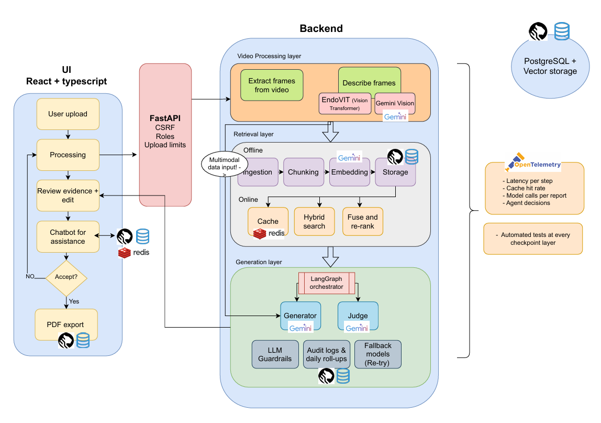
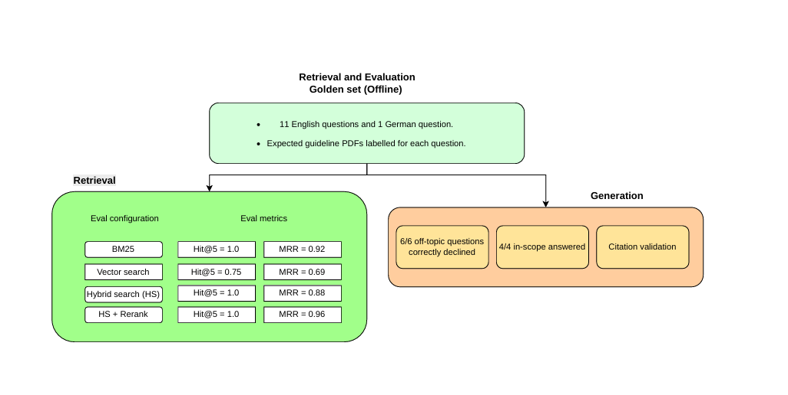

# SurgiDoc


**An agentic documentation assistant that turns an endoscopy or surgery video into a source cited draft report. A clinician reviews, edits and approves the report before a PDF is issued.**

Endoscopists spend a large share of their time on procedure documentation. SurgiDoc drafts the report, shows where every statement comes from, and leaves the decision with the physician. Every report is a draft until a person approves it.

It started as a 48 hour project at the Black Forest Hackathon (Smart Health) and was then extended into a full system with retrieval, guardrails, access control, an audit trail, caching and tracing.

## Architecture



A React and TypeScript interface guides the reviewer from upload to evidence review, editing, approval and PDF export. A FastAPI layer applies CSRF protection, roles and upload limits. The backend has three layers.

- **Video processing.** Frames are extracted and described through a replaceable vision interface, with EndoViT and Gemini vision behind it.
- **Retrieval.** Guideline documents are ingested, chunked, embedded and stored in PostgreSQL with vector storage. Queries run BM25 and vector search, fuse the results with reciprocal rank fusion, and rerank to the five best passages. Redis caches repeated queries.
- **Generation.** A LangGraph workflow runs a generator and a separate judge behind guardrails, audit logs and fallback models.

## How it checks its own work

- Every statement in a report must cite a retrieved source, either a frame finding or a guideline passage.
- A deterministic check rejects statements with no valid citation before any further model call is made.
- A separate judge model then reviews the draft against the retrieved context and approves it or returns feedback. Regeneration is limited to three attempts, and unreadable judge output counts as not approved, so the system fails closed.
- Retrieved text is passed to the models as data, not as instructions, as a defence against prompt injection.

## Governance and security

- Pydantic schema validation and content guardrails run before a reviewer sees the output.
- Approval is bound to a hash of the report content, so any edit resets it. A final PDF is produced only from an approved, hash verified report.
- Role based access separates the people who run the pipeline from those who approve. Every allowed and denied action goes to an append only, hash chained audit log.
- Stored reports are encrypted with AES-GCM. The web layer enforces CSRF tokens, host and origin checks, security headers and upload limits.
- Secrets live in a git ignored `keys.txt` and never in the repository.

## Evaluation



Retrieval and generation are evaluated offline on a golden set of 12 questions, 11 in English and one in German, with the expected guideline documents labelled for each question.

| Retrieval configuration | Hit@5 | MRR |
|---|---|---|
| BM25 | 1.00 | 0.92 |
| Vector search | 0.75 | 0.69 |
| Hybrid search | 1.00 | 0.88 |
| Hybrid search with reranking | 1.00 | 0.96 |

For generation, all 6 off topic questions were declined and all 4 in scope questions were answered, with citation validation applied to the answers.

OpenTelemetry records latency per step, cache hit rate, model calls per report and agent decisions.

## Run it

```bash
pip install -e ".[dev]"
python -m pytest -q          # offline, mocked services, no keys needed

cd frontend && npm ci && npm run build && cd ..
python -m surgidoc.webui --port 8765 --keys keys.txt
```

The web interface binds to the loopback address only. Service credentials go into `keys.txt`, see `SPEC.md` and `DECISIONS.md` for the entries.

## Stack

Python, LangGraph, FastAPI, PostgreSQL with vector storage, Redis, OpenTelemetry, Pydantic, React, TypeScript, Vite, pytest, Vitest, GitHub Actions.

## Documentation

- [`SPEC.md`](SPEC.md) lists the requirements and acceptance criteria.
- [`DECISIONS.md`](DECISIONS.md) records the design decisions and the reasons behind them.

## Data and licences

SurgiDoc was built on public datasets and public endoscopy guideline documents. Some of these carry non commercial licences, so this is a non commercial prototype and not a medical device. It never makes diagnostic claims.
